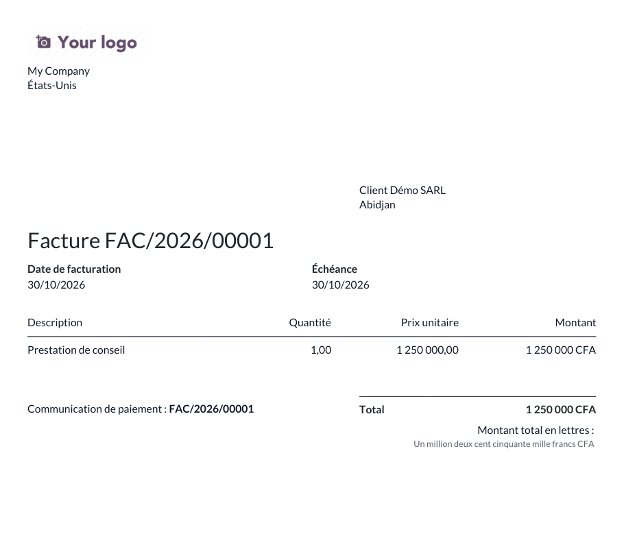
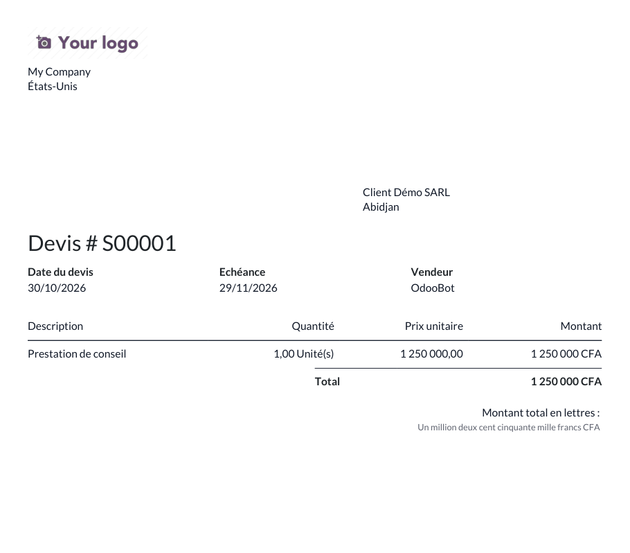

# Odoo Amount to Text (French)

🇫🇷 [Français](#français) · 🇬🇧 [English](#english)

## Français

Le module `amount_to_text_fr` affiche le montant total en toutes lettres et en français sous le total des factures et des devis imprimés (PDF).
Le franc CFA (XOF, XAF) s'écrit sans centimes (« Un million deux cent cinquante mille francs CFA ») ; les autres devises utilisent leurs libellés Odoo (« Mille deux cent trente-quatre euros et cinquante-six cents »).

### Prérequis

- Odoo 19 (Community ou Enterprise), modules `account` et `sale`
- Bibliothèque Python `num2words` (déjà présente dans l'image Docker officielle `odoo:19`)

### Installation

1. Copiez le dossier `amount_to_text_fr` dans votre chemin d'addons.
2. Redémarrez Odoo et mettez à jour la liste des applications.
3. Installez **Amount to Text (French)** : le montant en lettres apparaît sur les factures et devis imprimés.

Les libellés des devises (hors franc CFA) se modifient dans *Comptabilité > Configuration > Devises* (champs « Unité » et « Sous-unité »).

### Versions supportées

Une branche par version d'Odoo : [`19.0`](https://github.com/Junmodeste/odoo-amount-to-text-fr/tree/19.0) (cette branche), [`18.0`](https://github.com/Junmodeste/odoo-amount-to-text-fr/tree/18.0), [`17.0`](https://github.com/Junmodeste/odoo-amount-to-text-fr/tree/17.0). Tests automatisés (GitHub Actions) sur Odoo 19 Community (image `odoo:19`) + PostgreSQL 16, à chaque push.

### Licence

[LGPL-3](LICENSE)

### Auteur

Koffi Modeste Junior — [@Junmodeste](https://github.com/Junmodeste)

## English

The `amount_to_text_fr` module prints the total amount in French words below the total of printed invoices and quotations (PDF).
CFA franc (XOF, XAF) is written without cents ("Un million deux cent cinquante mille francs CFA"); other currencies use their Odoo unit labels ("Mille deux cent trente-quatre euros et cinquante-six cents").

### Requirements

- Odoo 19 (Community or Enterprise), `account` and `sale` modules
- Python library `num2words` (already shipped in the official `odoo:19` Docker image)

### Installation

1. Copy the `amount_to_text_fr` folder into your addons path.
2. Restart Odoo and update the apps list.
3. Install **Amount to Text (French)**: the amount in words is printed on invoices and quotations.

Currency labels (except CFA franc) can be edited in *Accounting > Configuration > Currencies* ("Unit" and "Subunit" fields).

### Supported versions

One branch per Odoo version: [`19.0`](https://github.com/Junmodeste/odoo-amount-to-text-fr/tree/19.0) (this branch), [`18.0`](https://github.com/Junmodeste/odoo-amount-to-text-fr/tree/18.0), [`17.0`](https://github.com/Junmodeste/odoo-amount-to-text-fr/tree/17.0). Automated tests (GitHub Actions) run on Odoo 19 Community (`odoo:19` image) + PostgreSQL 16 on every push.

### License

[LGPL-3](LICENSE)

### Author

Koffi Modeste Junior — [@Junmodeste](https://github.com/Junmodeste)
